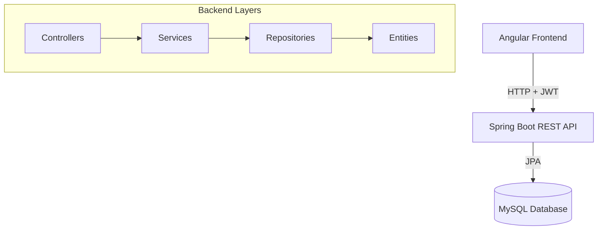
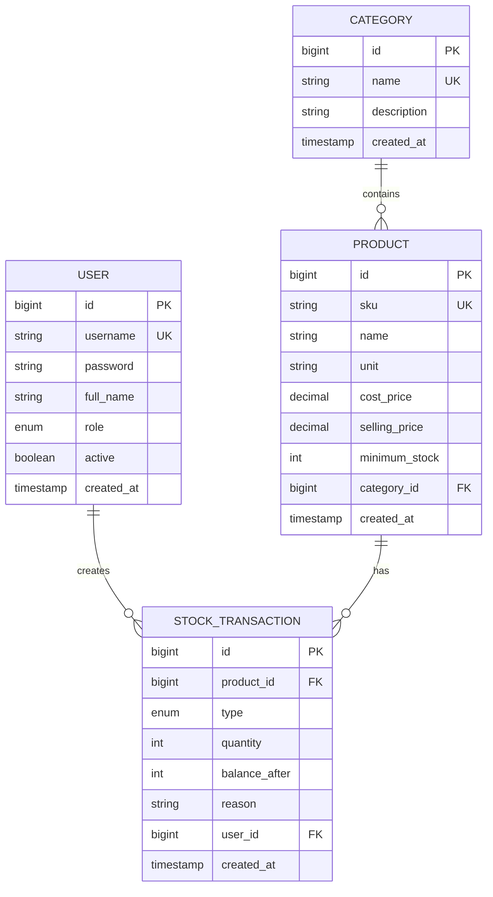
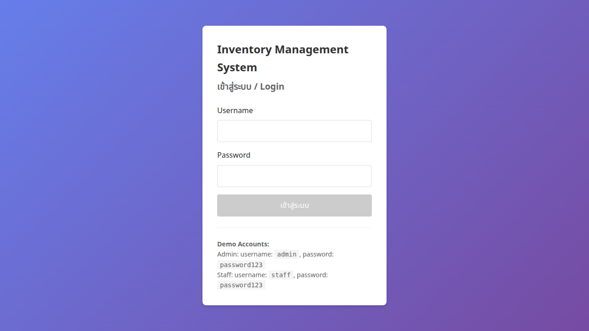
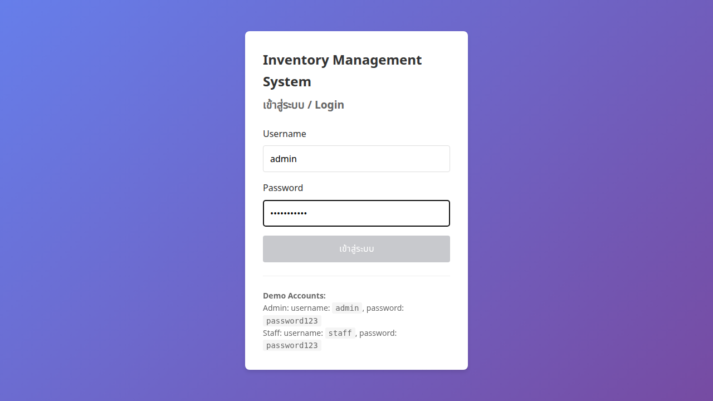

# Inventory Management System
# ระบบจัดการสต็อกสินค้า

[English](#english) | [ไทย](#thai)

---

## <a name="english"></a>English

### Overview

A full-stack inventory management system built with Angular, Spring Boot, and MySQL. This application is designed for small shops to manage products, categories, stock transactions, and generate reports.

**Tech Stack:**
- **Frontend:** Angular 17 (Standalone Components)
- **Backend:** Spring Boot 3 with Java 17
- **Database:** MySQL 8
- **Authentication:** JWT
- **Containerization:** Docker & Docker Compose

### Features

✅ **Authentication & Authorization**
- JWT-based login
- Role-based access control (Admin, Staff)
- Secure API endpoints

✅ **Product Management**
- CRUD operations for products
- SKU, name, unit, cost/selling price, minimum stock
- Search and filter by name, SKU, or category
- Pagination support

✅ **Category Management**
- CRUD operations for categories
- Admin-only access

✅ **Stock Transactions**
- Stock IN: Add inventory
- Stock OUT: Remove inventory (with stock validation)
- Stock ADJUSTMENT: Correct inventory discrepancies
- Transaction history with user tracking
- Real-time stock calculation

✅ **Reports & Analytics**
- Current stock report with valuation
- Low stock alerts
- Stock movement by date range
- Dashboard with key metrics:
  - Total products
  - Low stock count
  - Total stock value
  - Top moving products
  - Stock value by category

✅ **Excel Import/Export**
- Export stock reports to Excel (.xlsx)
- Import products from Excel with validation
- Download product import template

✅ **Quality Features**
- Flyway database migrations
- Layered architecture (Controller → Service → Repository)
- DTOs for clean data transfer
- Global exception handling
- Comprehensive unit tests
- Optimized queries (N+1 prevention)

### Architecture



### Entity Relationship Diagram



### Quick Start

#### Prerequisites
- Docker & Docker Compose
- Git

#### Run with Docker Compose

1. Clone the repository:
```bash
git clone <repository-url>
cd inventory-management-system
```

2. Copy environment file:
```bash
cp .env.example .env
```

3. Start all services:
```bash
docker-compose up -d
```

4. Access the application:
- **Frontend:** http://localhost
- **Backend API:** http://localhost:8080/api

5. Login with demo accounts:
- **Admin:** `admin` / `password123`
- **Staff:** `staff` / `password123`

#### Development Setup

**Backend:**
```bash
cd backend
mvn spring-boot:run
```

**Frontend:**
```bash
cd frontend
npm install
npm start
```

Access frontend at http://localhost:4200

### Demo Accounts

| Username | Password | Role | Permissions |
|----------|----------|------|-------------|
| admin | password123 | ADMIN | Full access (CRUD products, categories, all reports) |
| staff | password123 | STAFF | View products, create stock transactions, view reports |

### API Overview

**Authentication:**
- `POST /api/auth/login` - User login

**Products:**
- `GET /api/products` - List products (with search, filter, pagination)
- `GET /api/products/{id}` - Get product details
- `POST /api/products` - Create product (Admin only)
- `PUT /api/products/{id}` - Update product (Admin only)
- `DELETE /api/products/{id}` - Delete product (Admin only)

**Categories:**
- `GET /api/categories` - List all categories
- `POST /api/categories` - Create category (Admin only)
- `PUT /api/categories/{id}` - Update category (Admin only)
- `DELETE /api/categories/{id}` - Delete category (Admin only)

**Stock Transactions:**
- `POST /api/stock-transactions` - Create transaction
- `GET /api/stock-transactions/product/{id}` - Get product transaction history
- `GET /api/stock-transactions/product/{id}/current-stock` - Get current stock

**Reports:**
- `GET /api/reports/stock` - Current stock report
- `GET /api/reports/stock/export` - Export stock report to Excel
- `GET /api/reports/stock-movement` - Stock movement report (by date range)
- `GET /api/reports/low-stock` - Low stock products
- `GET /api/reports/dashboard` - Dashboard summary data

**Excel:**
- `GET /api/excel/template` - Download product import template
- `POST /api/excel/import` - Import products from Excel (Admin only)

### Testing

**Run Backend Tests:**
```bash
cd backend
mvn test
```

**Run Frontend Tests:**
```bash
cd frontend
npm test
```

### Screenshots


*Login page with demo account support*


*Admin user authentication*

For complete runtime verification results with all feature tests, see [RUNTIME_VERIFICATION.md](RUNTIME_VERIFICATION.md).
- Dashboard view
- Product management
- Stock transactions
- Reports and analytics

### Future Improvements

- [ ] Multi-warehouse support
- [ ] Barcode scanning integration
- [ ] Advanced reporting with charts (Chart.js integration)
- [ ] Email notifications for low stock
- [ ] Product images
- [ ] Supplier management
- [ ] Purchase order system
- [ ] Sales tracking
- [ ] Mobile responsive improvements
- [ ] Dark mode

---

## <a name="thai"></a>ไทย

### ภาพรวม

ระบบจัดการสต็อกสินค้าแบบครบวงจร สร้างด้วย Angular, Spring Boot และ MySQL เหมาะสำหรับร้านค้าขนาดเล็กในการจัดการสินค้า หมวดหมู่ การเคลื่อนไหวสต็อก และสร้างรายงาน

**เทคโนโลยี:**
- **Frontend:** Angular 17 (Standalone Components)
- **Backend:** Spring Boot 3 with Java 17
- **Database:** MySQL 8
- **Authentication:** JWT
- **Containerization:** Docker & Docker Compose

### ฟีเจอร์

✅ **ระบบเข้าสู่ระบบและสิทธิ์การใช้งาน**
- เข้าสู่ระบบด้วย JWT
- แบ่งสิทธิ์ตามบทบาท (ผู้ดูแลระบบ, พนักงาน)
- API ที่ปลอดภัย

✅ **จัดการสินค้า**
- เพิ่ม แก้ไข ลบ ดูรายการสินค้า
- รหัสสินค้า ชื่อ หน่วย ราคาทุน/ขาย สต็อกขั้นต่ำ
- ค้นหาและกรองตามชื่อ รหัส หรือหมวดหมู่
- รองรับการแบ่งหน้า

✅ **จัดการหมวดหมู่**
- เพิ่ม แก้ไข ลบหมวดหมู่
- เฉพาะผู้ดูแลระบบ

✅ **บันทึกการเคลื่อนไหวสต็อก**
- รับสินค้าเข้า: เพิ่มสต็อก
- เบิกสินค้าออก: ลดสต็อก (ตรวจสอบสต็อกคงเหลือ)
- ปรับปรุงสต็อก: แก้ไขความผิดพลาด
- ประวัติการทำรายการพร้อมผู้ทำรายการ
- คำนวณสต็อกแบบเรียลไทม์

✅ **รายงานและวิเคราะห์**
- รายงานสต็อกปัจจุบันพร้อมมูลค่า
- แจ้งเตือนสินค้าใกล้หมด
- รายงานการเคลื่อนไหวสต็อกตามช่วงวันที่
- แดชบอร์ดแสดงข้อมูลสำคัญ:
  - จำนวนสินค้าทั้งหมด
  - จำนวนสินค้าใกล้หมด
  - มูลค่าสต็อกรวม
  - สินค้าที่เคลื่อนไหวมากที่สุด
  - มูลค่าสต็อกแยกตามหมวดหมู่

✅ **นำเข้า/ส่งออก Excel**
- ส่งออกรายงานสต็อกเป็น Excel (.xlsx)
- นำเข้าสินค้าจาก Excel พร้อมตรวจสอบข้อมูล
- ดาวน์โหลดเทมเพลตนำเข้าสินค้า

✅ **คุณภาพโค้ด**
- Flyway สำหรับจัดการฐานข้อมูล
- สถาปัตยกรรมแบบแบ่งชั้น (Controller → Service → Repository)
- DTOs สำหรับการส่งข้อมูล
- จัดการ Exception แบบรวมศูนย์
- Unit Tests ครอบคลุม
- Query ที่ optimize แล้ว (ป้องกัน N+1)

### เริ่มต้นใช้งาน

#### ความต้องการ
- Docker & Docker Compose
- Git

#### รันด้วย Docker Compose

1. Clone repository:
```bash
git clone <repository-url>
cd inventory-management-system
```

2. คัดลอกไฟล์ environment:
```bash
cp .env.example .env
```

3. เริ่ม services ทั้งหมด:
```bash
docker-compose up -d
```

4. เข้าใช้งานแอปพลิเคชัน:
- **Frontend:** http://localhost
- **Backend API:** http://localhost:8080/api

5. เข้าสู่ระบบด้วยบัญชีทดสอบ:
- **ผู้ดูแลระบบ:** `admin` / `password123`
- **พนักงาน:** `staff` / `password123`

### บัญชีทดสอบ

| Username | Password | Role | สิทธิ์การใช้งาน |
|----------|----------|------|-------------|
| admin | password123 | ADMIN | ใช้งานได้ทุกฟีเจอร์ (จัดการสินค้า หมวดหมู่ รายงานทั้งหมด) |
| staff | password123 | STAFF | ดูสินค้า บันทึกการเคลื่อนไหวสต็อก ดูรายงาน |

### ภาพหน้าจอ

ภาพหน้าจอมีอยู่ในโฟลเดอร์ [docs/](./docs/):
- หน้าแดชบอร์ด
- จัดการสินค้า
- บันทึกสต็อก
- รายงานและวิเคราะห์

### แนวทางพัฒนาต่อ

- [ ] รองรับหลายคลังสินค้า
- [ ] สแกนบาร์โค้ด
- [ ] รายงานกราฟขั้นสูง (Chart.js)
- [ ] แจ้งเตือนทาง Email เมื่อสินค้าใกล้หมด
- [ ] รูปภาพสินค้า
- [ ] จัดการซัพพลายเออร์
- [ ] ระบบสั่งซื้อสินค้า
- [ ] ติดตามการขาย
- [ ] ปรับปรุง UI สำหรับมือถือ
- [ ] โหมดมืด

### การทดสอบ

**รัน Backend Tests:**
```bash
cd backend
mvn test
```

**รัน Frontend Tests:**
```bash
cd frontend
npm test
```

---

## License

MIT License - see LICENSE file for details.

## Contributing

This project is a portfolio project. Feel free to fork and modify for your own use.

## Contact

For questions or feedback, please open an issue on GitHub.
